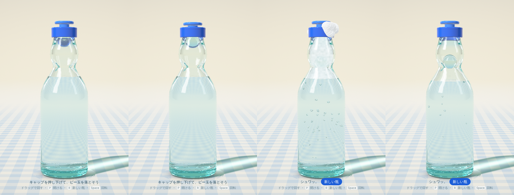

# ラムネ



ブラウザで触れるラムネ瓶です。キャップを押し込むとビー玉がポンと落ち、泡が首をせり上がって、キャップからあふれます。

ガラスの屈折、水色の瓶の色、ビー玉、液の中を上る泡までを、1 枚のフラグメントシェーダーでレイトレースして描いています。
[three.js](https://threejs.org) と [Vite](https://vite.dev) で作りました。

## 動かし方

```bash
npm install
npm run dev
```

http://localhost:5183 を開きます。

公開版：https://kawade502.github.io/ramume/ （`main` に push すると [GitHub Actions](.github/workflows/pages.yml) が自動でビルドして公開します）

ローカルで `npm run build` を実行すると `dist/` に静的ファイルができるので、GitHub Pages などにそのまま置けます。

| 操作 | 動き |
| --- | --- |
| キャップを下へドラッグ | 玉押しが沈み、押し切るとビー玉が落ちる |
| キャップをタップ、または **P** | 自動で押して開ける |
| それ以外の場所をドラッグ | 瓶を回す（左右）、見下ろす角度を変える（上下） |
| **R**、または「新しい瓶」 | 新しい瓶に戻す |
| **Space** | ゆっくり回るのを止める／再開する |

## 仕組み

**瓶の形。** [`src/bottle.js`](src/bottle.js) に、瓶の外側と内側の輪郭を高さごとの半径 `[r, y]`（ミリメートル）で書いています。
輪郭は行き過ぎない 3 次補間で滑らかにし、1024 段の表にしてテクスチャに入れます。
シェーダーはこの表を引いて、回転体としての距離を求めます。

- 底：上げ底と、内側の厚いガラスを足して作る
- 口：丸いビード（トーラス）で閉じる
- くびれの 2 つの凹み：角度によって半径をずらす

ビー玉の 2 つの止まる位置は、手で決めずに形から計算しています。

- 開ける前：ガス圧で口に押し付けられる位置
- 開けた後：凹みに引っかかる位置

**光。** [`src/shader.js`](src/shader.js) が画面の 1 ピクセルごとに光線を飛ばします。

- 光線は空気→ガラス→ラムネ→ガラス…と面を越えるたびに、フレネル反射と屈折に分かれる（全反射も扱う）
- ガラスとビー玉は、通った距離のぶん色を吸収する。瓶の縁や厚い底が水色に見えるのはこのため
- ビー玉、液面、液の中の泡は式で直接交点を求め、それ以外の面は距離場をたどって探す
- 光線の行き先は小さなスタジオ。ソフトボックスと黒い板、空色のグラデーション、ギンガムチェックの床がある
- 床の影と集光（コースティクス）は、床の点から光源へ向かう線が瓶の輪郭にどこまで近づくかで描く

**泡。** [`src/foam.js`](src/foam.js) は、開けた瞬間に 1 になって減っていく「圧力」で 3 種類の泡を動かします。

- 液の中の泡：底や壁から生まれ、ふくらみながら上る
- 首の中の泡の層：一気にせり上がり、白く濁った層として描く
- あふれた泡：玉押しのつばの下から出て、リングの上を広がり、首を伝って垂れる

**省エネ。** 動いている間は低い解像度で描いて引き伸ばし、フレームが重ければ自動でさらに下げます。
すべて止まったら最高解像度で 1 枚だけ描いて、描画を休みます。30 秒触られなければ、回転も止まります。

## ファイル

```
src/
├── main.js     レンダラー、入力、開栓の動き、描画ループ
├── bottle.js   瓶の寸法と輪郭、ビー玉の止まる位置
├── shader.js   シーン全体のレイトレース（GLSL）
├── foam.js     泡のシミュレーション
└── style.css
```

## クレジット

Ann Nguyen さん（[@ann_nnng](https://x.com/ann_nnng)）の [vibe-coding](https://github.com/annnguyentt/vibe-coding) コレクションに刺激を受けて作りました。
特に cd-case と cocktails の「身近な物をひとつ、光まで作り込む」という考え方を参考にしています。コードは独自に書いたものです。

AI（Claude）とのバイブコーディングで作りました。
