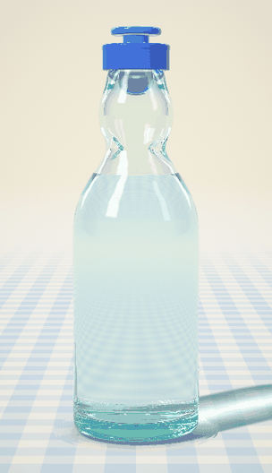
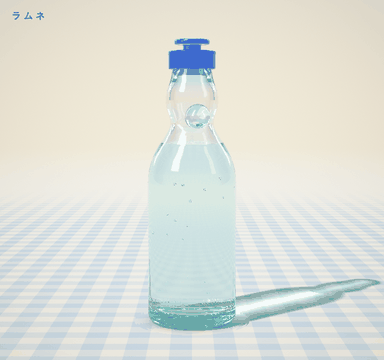

# ラムネ



ブラウザで触れるラムネ瓶です。キャップを押し込むとビー玉が「ポン」と外れて「カラン」と落ち、泡が首をせり上がって、キャップからあふれます。音も鳴ります。
開けたあとは瓶をつかんで傾けると、ビー玉が中で転がり、ラムネの水面は水平のまま揺れます。




ガラスの屈折、水色の瓶の色、ビー玉、液の中を上る泡までを、1 枚のフラグメントシェーダーでレイトレースして描いています。
[three.js](https://threejs.org) と [Vite](https://vite.dev) で作りました。

## 動かし方

```bash
npm install
npm run dev
```

http://localhost:5183 を開きます。

公開版：https://kawade502.github.io/ramume/ （`main` に push すると [GitHub Actions](.github/workflows/pages.yml) が自動でビルドして公開します）

ローカルで `npm run build` を実行すると `dist/` に静的ファイルができるので、GitHub Pages などにそのまま置けます。

| 操作 | 動き |
| --- | --- |
| キャップを下へドラッグ | 玉押しが沈み、押し切るとビー玉が落ちる |
| キャップをタップ、または **P** | 自動で押して開ける |
| 瓶をつかんで左右にドラッグ、または **←** **→** | 瓶を持ち上げて傾ける（最大 120°）。離すと揺れながら戻って、コトッと置かれる |
| スマホの「傾き」ボタン | スマホを左右に傾けると、瓶も傾く |
| 瓶のまわりをドラッグ | 瓶を軸のまわりに回す（左右）、見下ろす角度を変える（上下） |
| **R**、または「新しい瓶」 | 新しい瓶に戻す |
| **Space** | 瓶をゆっくり回し続ける／止める |
| **M**、または右上のボタン | 音を消す／出す |

## 仕組み

**瓶の形。** [`src/bottle.js`](src/bottle.js) に、瓶の外側と内側の輪郭を高さごとの半径 `[r, y]`（ミリメートル）で書いています。
輪郭は行き過ぎない 3 次補間で滑らかにし、1024 段の表にしてテクスチャに入れます。
シェーダーはこの表を引いて、回転体としての距離を求めます。

- 底：上げ底と、内側の厚いガラスを足して作る
- 口：丸いビード（トーラス）で閉じる
- くびれの 2 つの凹み：角度によって半径をずらす

開ける前のビー玉の位置（ガス圧で口に押し付けられる位置）は、手で決めずに形から計算しています。

**ビー玉と傾き。** [`src/marble.js`](src/marble.js) は、開けた後のビー玉を瓶の中で自由に転がします。

- ビー玉の表面にとった 60 個の点が、内側の壁（距離場）にめり込んだら押し戻す
- 速いときは細かく刻んで計算するので、凹みをすり抜けない
- 液の中では浮力で軽くなり、抵抗でゆっくり動く
- 凹みは幅を広くとってあるので、どう傾けても胴までは落ちない

実物と同じように、凹みを下に向けて傾けるとビー玉が凹みに引っかかり、凹みを横に向けると口のほうへ転がって栓をします。
最初は凹みを手前と奥に向けてあるので、左右に傾けるとビー玉が転がります。凹みの向きは、まわりをドラッグして変えられます。

傾けても液面は水平です。[`src/bottle.js`](src/bottle.js) が、液の体積が変わらない水平な面の高さを二分法で解いています。
瓶を高さごとの輪切りにし、それぞれの円が面より下にある部分の面積を足して体積を出します。
開けたときにあふれて減るのは 1.5ml ほどで、液面は 1mm ちょっとしか下がりません。

**光。** [`src/shader.js`](src/shader.js) が画面の 1 ピクセルごとに光線を飛ばします。

- 光線は空気→ガラス→ラムネ→ガラス…と面を越えるたびに、フレネル反射と屈折に分かれる（全反射も扱う）
- ガラスとビー玉は、通った距離のぶん色を吸収する。瓶の縁や厚い底が水色に見えるのはこのため
- ビー玉、液面、液の中の泡は式で直接交点を求め、それ以外の面は距離場をたどって探す
- 光線の行き先は小さなスタジオ。ソフトボックスと黒い板、空色のグラデーション、ギンガムチェックの床がある
- 床の影と集光（コースティクス）は、床の点から光源へ向かう線が瓶の輪郭にどこまで近づくかで描く
- 瓶を傾けたときは、光線を瓶のローカル座標に移してから同じ計算をする。影も傾いた瓶の形から落ちる

**泡。** [`src/foam.js`](src/foam.js) は、開けた瞬間に 1 になって減っていく「圧力」で泡を動かします。

- 液の中の泡：ガラスの決まった場所から列になって湧き、ふくらみながら上る
- 液の濁り：開けた直後は細かい泡で液全体が白く濁り、下から上へ流れる筋になって晴れていく
- 首の中の泡の層：一気にせり上がる。ガラスに押し付けられた泡の膜の模様（ボロノイ）が透けて見える
- あふれた泡：玉押しのつばの下から盛り上がり、リングの上を広がって首を伝って垂れる。
  小さな泡ひとつひとつが光を返し、垂れるうちに泡がつぶれて透明なしずくに戻る

**音。** [`src/sound.js`](src/sound.js) は、音声ファイルを使わずに Web Audio で合成しています。

- ポン：空気が抜ける短いノイズと、瓶の中で響く低い音
- カラン：ビー玉が跳ねるたびに鳴る、整数倍にならないガラスの倍音。跳ねる勢いで音量が変わる
- シュワシュワ：泡がはじける細かな音の粒を並べたものと、吹き出す瞬間のシャー
- ブクブク：あふれる泡の量に合わせて鳴る、低い泡の音
- コロコロ：ビー玉が瓶の内側を転がっている間、速さに合わせて鳴る
- カチッ（玉押し）、コトッ（瓶を置く）

ブラウザの決まりで、最初にクリックかキーを押すまでは音が出ません。

**省エネ。** 動いている間は低い解像度で描いて引き伸ばし、フレームが重ければ自動でさらに下げます。
すべて止まったら最高解像度で 1 枚だけ描いて、描画を休みます。ビー玉も止まったら計算を休みます。

## ファイル

```
src/
├── main.js     レンダラー、入力、開栓の動き、描画ループ
├── bottle.js   瓶の寸法と輪郭、液面の計算、ビー玉の止まる位置
├── marble.js   ビー玉の転がり
├── shader.js   シーン全体のレイトレース（GLSL）
├── foam.js     泡のシミュレーション
├── sound.js    効果音の合成
└── style.css
```

## クレジット

Ann Nguyen さん（[@ann_nnng](https://x.com/ann_nnng)）の [vibe-coding](https://github.com/annnguyentt/vibe-coding) コレクションに刺激を受けて作りました。
特に cd-case と cocktails の「身近な物をひとつ、光まで作り込む」という考え方を参考にしています。コードは独自に書いたものです。

AI（Claude）とのバイブコーディングで作りました。
